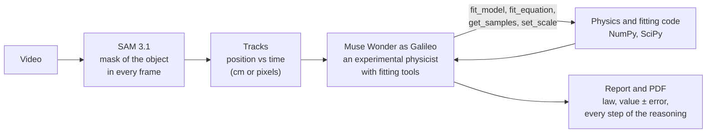

# Galileo

**Film something moving. SAM 3.1 tracks it, Muse Wonder finds the physical law behind the motion
and measures it, with an honest error bar.**

Measuring gravity in a school lab usually takes photogates or a stopwatch and many repeats. Galileo
needs a video and one length you know. It turns a phone clip, a lab recording or a video from the
web into a real experiment: the law, the number, the uncertainty, and a PDF lab report that shows
how it got there.

Built for the Meta Global AI Developer Hackathon (2026) with **SAM 3.1**, **Muse Wonder** and
**Muse Spark** on the Meta Model API.

**Demo video:** https://youtu.be/REPLACE_ME (2 min)
**Example report:** [docs/example-report.pdf](docs/example-report.pdf), made by the app from the run below


## A real lab video, 5 seconds long

[Video 5 of the University of Toronto's simple harmonic motion videos](https://practicals.physics.utoronto.ca/practicals/document/162/):
a rigid pendulum (a rod with a wooden block). The lab page gives one number: 33 cm from the pivot to
the centre of mass. No ruler is used.

| | |
|---|---|
| What I typed | What moves: `wooden block`. What I know: `33 cm from the pivot to the centre of mass` |
| SAM 3.1 | tracked the block in every frame from 1.03 s to 4.90 s, no gaps |
| Muse Wonder | recognised a rigid pendulum, fitted it with its tools, compared three candidate laws |
| **Result** | **g = 9.803 ± 0.089 m/s²**, 0.04% from standard gravity (9.80665), inside the error bar |
| Also measured | period 1.15959 ± 0.00017 s, amplitude 17.5°, damping 0.0061 /s (Q ≈ 447) |
| Cost and time | 3 model calls, 4 tool calls, 70 s, about $0.18 of Muse Wonder usage |

The error bar is honest: Galileo reports that it comes almost entirely from the ±0.3 cm uncertainty
of the length, because timing from video is very precise. It also explains why the tracked arc
radius (522 px) is not the 33 cm effective length of a rigid pendulum, instead of treating the
difference as an error.

## How it works



1. **Track (SAM 3.1).** The clip is uploaded through the Files API and SAM 3.1 segments the object
   named by a short prompt ("wooden block", "orange ball") in every frame, streaming its masks back.
   Galileo turns the masks into centroid tracks and an overlay video. If a reference object is in
   view (an A4 sheet, a metre stick), SAM 3.1 also segments it on one frame to set the centimetre
   scale. Leave the prompt empty and **Muse Spark** looks at the first frame and picks what to track.
2. **Analyse (Muse Wonder).** Muse Wonder gets an overview of the tracks, your notes and three images
   (calibration frame, tracking frame, paths). It then works like an experimental physicist with five
   tools: look at raw samples, fit a standard model, fit any law it writes itself, set the scale from
   a known length, and submit the report. It must test at least one alternative law and compare them
   by BIC, and it may only use numbers that come from the tools.
3. **Report.** The result, the fit with its residuals, SAM's tracking, all results, the laws compared,
   data quality, next steps and the full reasoning trail, on the page and as a PDF.

What makes the numbers trustworthy:

- **Uncertainties are propagated, not guessed.** Length and scale uncertainties are included, the
  pendulum fit applies the finite-amplitude correction, and residuals are checked for structure.
- **No ruler needed.** A length in your notes is enough: a pendulum with a known length needs no scale
  at all, and for anything else Galileo measures that length in pixels and calibrates itself.
- **Safe custom laws.** Equations written by the model are parsed with a whitelisted syntax tree and
  fitted by multi-start least squares. Nothing it writes is executed.
- **Reproducible runs.** Every run folder keeps the tracks, SAM's raw answers, plots, report.json and
  the agent transcript, so a run can be re-analysed without calling SAM again.

## What it can measure

| Motion | What Galileo reports |
|---|---|
| Pendulum (string or rigid) | g, period, amplitude, damping and Q |
| Spring or anything oscillating | period, damping, Q; spring constant when you give the mass |
| Free fall, projectile | g |
| Ball or block on a ramp | acceleration, rolling resistance or friction, what kind of ball it is |
| Constant velocity, domino chain | speed, wave speed |
| Anything else | the law Galileo writes itself, compared with alternatives by BIC |

## Run it

Python 3.10 or newer. FFmpeg comes with the `imageio-ffmpeg` package, so there is nothing else to
install.

```
git clone <this repo>
cd <repo folder>
python -m venv .venv
.venv\Scripts\activate              (macOS/Linux: source .venv/bin/activate)
pip install -r requirements.txt
copy .env.example .env              (macOS/Linux: cp .env.example .env)
```

Paste your Meta Model API key into `.env` as `MODEL_API_KEY=...` (dev.meta.ai, Model API dashboard),
then:

```
python check_api.py     # every line should say [ok]
python app.py           # opens http://127.0.0.1:7860
```

In the page: 1. drop in a video, 2. say what moves, 3. type what you know (a length, a height, a
mass), 4. say where the scale comes from, then press **Track and analyse**. When it finishes,
**Download the PDF report** saves the lab report.

**Try the example above:** download
[shmvideo5pendulum.mp4](https://practicals.physics.utoronto.ca/media/uploads/2020/10/08/shmvideo5pendulum.mp4),
then use What moves `wooden block`, What you know `Rigid pendulum: a rod with a wooden block on the
end. 33 cm from the pivot to the centre of mass (given by the lab).` and the scale option
**No reference: Galileo uses the lengths in my notes**.

**Without filming anything:** `python make_test_clip.py pendulum` makes a synthetic clip with a known
answer (g = 9.807 m/s², L = 55 cm, an A4 sheet for the scale). On it, Galileo measured
g = 9.805 ± 0.053 m/s² with the length given.

### Command line

```
python track.py clip.mp4 --prompt "wooden block" --no-scale --out runs/toronto5
python galileo.py runs/toronto5 --note "33 cm from the pivot to the centre of mass"
python fit.py runs/toronto5 --model pendulum --length-cm 33
```

`track.py` writes tracks.csv, overlay.mp4, plot.png and summary.json. `galileo.py` writes report.md,
report.json, agent_transcript.md, the fit plots and `galileo-report-<run>.pdf`. `fit.py` fits one
model by hand. Scale options: `--ref-prompt "meter stick" --ref-long-cm 100` (an object of known size
in the video), `--px-per-cm 22.3` (a scale you measured) or `--no-scale` (lengths from your notes).

## Filming your own experiment

- Phone on a stand, landscape, pointing straight at the motion from 1.5 to 2 m. Never handheld.
- Normal video, 60 fps if possible, not slow motion. Bright light, plain background.
- Measure one length by hand (string length, drop height, ramp length) and type it in the notes.
  Or hold an A4 sheet in the plane of the motion for a second at the start.

## Project layout

```
app.py             the Galileo web app (Gradio)
track.py           video -> SAM 3.1 masks -> tracks, overlay video, scale check
galileo.py         the Muse Wonder agent from the command line
fit.py             one physics model by hand
check_api.py       is the key working, are the models there
make_test_clip.py  synthetic videos with known answers
oe/
  meta_api.py      Meta Model API: SAM 3.1 (image and streaming video), Muse Spark, Files API
  masks.py         SAM 3.1 output -> masks and centroids (meta-sam-parser)
  agent.py         Galileo: system prompt, tools, agent loop, report
  analysis.py      overview of a run, automatic time windows, model fitting on a run
  physics.py       pendulum, oscillator, free fall, projectile, ramp, dominoes
  equations.py     safe parsing and fitting of laws the model writes
  motion.py        release detection, periods, motion hints
  report.py        the result readout and the PDF report
  scale.py, video.py, plots.py, draw.py, config.py
```

## Limits

- The camera must not move, and the motion should be in a plane facing the camera. A reference object
  must be in that plane; 20 cm in front or behind changes the scale by about 10%.
- SAM 3.1 accepts up to 15,000 frames and 16 objects per frame. Galileo trims and resizes clips to
  1280 px before tracking.
- Galileo reports what the data supports: without any scale or known length, it gives only
  scale-free results (periods, angles, timings) and says what measurement would complete them.

## Credits

Pendulum video: "Videos of Simple Harmonic Motion", Physics Undergraduate Practicals, University of
Toronto (recorded by Professor Harlow). It is linked here, not included in this repository.
