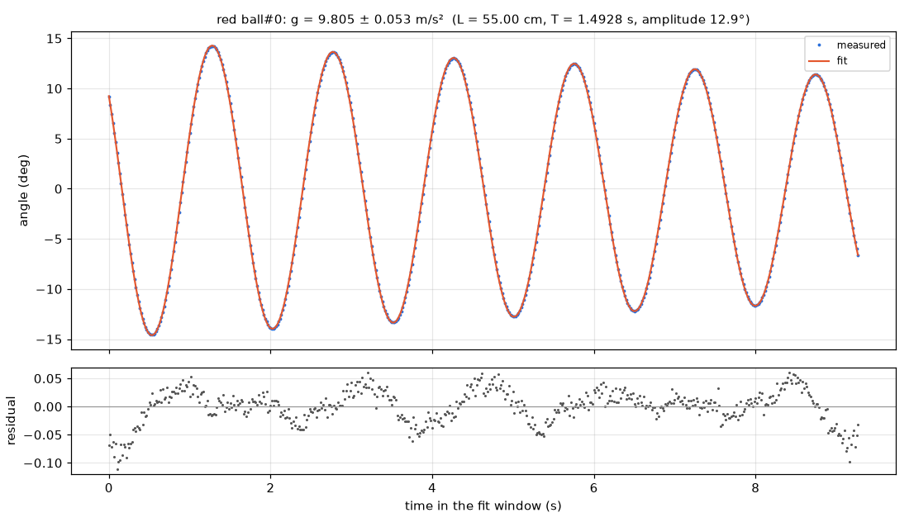

# Simple pendulum

**Measured g = 9.805 ± 0.053 m/s², just 0.01% below the reference 9.80665 m/s².**

**Law:** `θ(t) = θ0·e^(−γt)·cos(2πt/T + φ), with T ≈ 2π√(L/g) corrected for finite amplitude, so g = 4π²L/T_small²`

| Quantity | Value | Unit | Note |
|---|---|---|---|
| Gravitational acceleration g | 9.805 ± 0.053 | m/s² | From hand length L=55.0 cm and period; uncertainty dominated by ±0.3 cm length (±0.55%), period timing is negligible |
| Period T (at 12.9° amplitude) | 1.492850 ± 0.000018 | s | Small-angle period 1.48808 s used for g after amplitude correction |
| Arc radius (video cross-check of length) | 55.12 ± 0.55 | cm | Agrees with hand-measured 55.0 cm within uncertainty |
| Damping rate γ | 0.030156 ± 0.000055 | 1/s | From damped-cosine fit to θ(t); quality factor ~70 from pendulum fit |

### What this means

A red ball on a 55 cm string swings back and forth like a clock pendulum. Its swing angle follows a cosine wave whose height slowly shrinks because of air resistance and friction. Timing about six and a half swings very precisely gives the period, and combining that period with the string length gives gravity. The result, 9.805 ± 0.053 m/s², matches the accepted value 9.807 m/s², with the hand-measured string length limiting the accuracy.

### Models compared

| Model | BIC | rms | Verdict |
|---|---|---|---|
| `Damped pendulum: A*exp(-k*t)*cos(w*t+p) on theta` | -8377.7 | 0.00053 | Strongly preferred; R²=0.999989, matches pendulum fit |
| `Undamped pendulum: A*cos(w*t+p) on theta` | -4870.4 | 0.0124 | Rejected; BIC worse by ~3507 (>>10, decisive) because amplitude visibly decays |

### Data quality

- Full coverage: 600/600 frames, no gaps, t=0-9.98 s; fit window 0.717-9.983 s (557 points)
- Scale check excellent: blue sheet long side 10.034 px/cm vs short side 10.048 px/cm, agree within 0.1%
- Path follows a circular arc with rms 0.0095 cm and radius 55.12 cm vs hand 55.0 cm
- No warnings from pendulum fit; angle rms 0.029°

### Next steps

- Measure the string length to the bob centre more precisely than ±0.3 cm, e.g. with a caliper/tape under tension, to cut the main uncertainty
- Use a smaller release angle (<5°) to reduce the finite-amplitude correction
- Film for longer to average more periods and watch damping over more cycles

_Analysed by muse-wonder-1.0 in 3 model calls and 4 tool calls, about $0.13 of API usage (35 s)._
