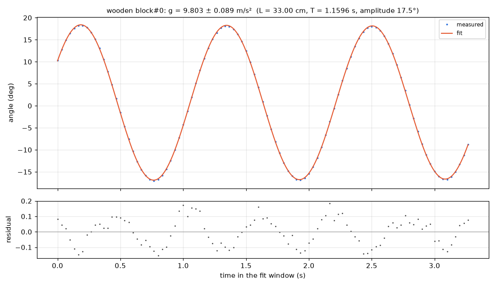

# Rigid pendulum — rod with a wooden block

**Using the lab length of 33 cm and a measured period of 1.1596 s, the pendulum gives g = 9.80 ± 0.09 m/s², in agreement with the standard 9.80665 m/s².**

**Law:** `θ(t) = θ0·e^(−γt)·cos(2πt/T + φ), with T = 2π√(L/g) including a finite-amplitude correction; here L = 33 cm and amplitude θ0 ≈ 17.5°`

| Quantity | Value | Unit | Note |
|---|---|---|---|
| Gravitational acceleration, g | 9.803 ± 0.089 | m/s² | From pendulum fit with L = 33.0 ± 0.3 cm; uncertainty is dominated by the ±0.3 cm (±0.9%) length uncertainty, the period contribution is negligible. 0.04% below standard g. |
| Oscillation period, T | 1.15959 ± 0.00017 | s | Measured over the fitted window 1.633–4.900 s; small-angle period from the same fit is 1.15282 s, showing the finite-amplitude correction at 17.5° matters at the ~0.6% level. |
| Swing amplitude | 17.52 | degrees | Initial angular amplitude from the pendulum fit; moderate amplitude, so the finite-amplitude pendulum model is preferred over a pure cosine. |
| Damping rate | 0.006061 | 1/s | Corresponds to a quality factor Q ≈ 447, i.e. very light damping over the ~3 observed cycles; damping is therefore poorly constrained compared with the period. |
| Arc radius of tracked block centroid | 522.5 | px | Geometric distance from fitted pivot to the tracked wooden-block centroid. For this rigid pendulum this is not the given 33 cm pivot-to-centre-of-mass/effective length, so it was not used as a pixel-to-cm calibration and any difference is not an error. |

### What this means

A wooden block on a rod swings back and forth like a clock pendulum, completing one swing every 1.16 seconds. Because the time for a pendulum swing depends on its length and on gravity, combining that very precise timing with the lab-measured 33 cm length gives the strength of gravity. The result, 9.80 ± 0.09 metres per second squared, matches the accepted Earth value. The swing barely fades during the video, showing friction and air resistance are very small here.

### Models compared

| Model | BIC | rms | Verdict |
|---|---|---|---|
| `Pendulum fit (fit_model, L = 33 cm, finite amplitude)` |  | 0.0015 | Best physical description: angle RMS 0.086° (0.0015 rad), arc RMS 0.41 px, no warnings; gives g = 9.803 ± 0.089 m/s². No BIC is returned by fit_model. |
| Damped cosine θ = A·exp(−γt)·cos(ωt + p) on angle | -853.2 | 0.0123 | Favoured over the undamped cosine by ΔBIC = 7.6, which is suggestive but not decisive (decisive is >10). RMS is in rad. It is only a small-angle approximation to the pendulum motion. |
| Undamped cosine θ = A·cos(ωt + p) on angle | -845.6 | 0.013 | Slightly worse than the damped cosine (ΔBIC = 7.6) and worse than the finite-amplitude pendulum fit; its near-competitiveness is consistent with very light damping over only about three cycles. |

### Data quality

- Tracking is clean: 117 points from 1.033 to 4.900 s with no gaps (largest gap 0 frames); the fit used 99 points from 1.633 to 4.900 s, starting 0.2 s after the 1.433 s release.
- Fit residuals are small: arc RMS 0.41 px and angular RMS 0.086°, with no fit warnings.
- There is no pixel scale in this run. This does not affect g because the period is scale-free and the lab length L = 33 cm was supplied; however the result relies entirely on that length, whose ±0.3 cm uncertainty dominates the ±0.09 m/s² error on g.
- Only about three cycles are observed, so the period is precise but the small damping rate/Q is weakly constrained.
- The 522 px arc radius is the pivot-to-tracked-block-centroid distance for a rigid rod-plus-block pendulum, not the given centre-of-mass/effective length, so it was not converted with the 33 cm value.

### Next steps

- Measure the effective pendulum length more precisely than ±0.3 cm, since this dominates the uncertainty in g.
- Film many more cycles to pin down the tiny damping and improve the period further.
- Add an independent ruler scale in the plane of swing to convert the 522 px arc radius to centimetres as a geometric cross-check (while keeping it distinct from the centre-of-mass length).
- Repeat at a smaller release angle to verify the finite-amplitude correction.

_Analysed by muse-wonder-1.0 in 3 model calls and 4 tool calls, about $0.18 of API usage (70 s)._
