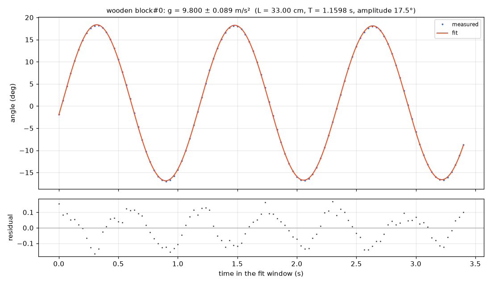

# Rigid pendulum — rod with wooden block

**Measured g = 9.80 ± 0.09 m/s² from the pendulum period and the given 33 cm length, within 0.1% of the standard 9.80665 m/s² and consistent within the uncertainty.**

**Law:** `θ(t) = θ0·e^(−γt)·cos(2πt/T + φ), with T ≈ 2π√(L/g) corrected for finite amplitude; L is the given effective length (pivot to centre of mass).`

| Quantity | Value | Unit | Note |
|---|---|---|---|
| Gravitational acceleration g | 9.800 ± 0.089 | m/s² | ±1 standard error; dominated by the 0.3 cm uncertainty in the given 33.0 cm length (≈0.9%), since the period is far more precise. Compared with 9.80665 m/s², difference −0.07%. |
| Oscillation period (at observed amplitude) | 1.15976 ± 0.00016 | s | ±1 standard error; scale-free timing measurement, 103 points in 1.5–4.9 s window. |
| Small-angle period | 1.153 | s | Amplitude-corrected period reported by the pendulum fit; shorter than the observed period as expected at finite amplitude. |
| Swing amplitude | 17.5 | deg | Moderate amplitude, so the finite-amplitude period correction matters at the ~0.6% level. |
| Arc radius of tracked block point | 523.4 | px | Cross-check of pivot location and circular arc only (arc RMS 0.42 px). This is the pivot-to-tracked-point distance, not the effective pendulum length, so it was NOT equated to 33 cm and no px-to-cm scale was set. |
| Damping rate | 0.006083 | 1/s | Very light damping; quality factor ≈445 from the pendulum fit. Only ~3 cycles were recorded, so damping is poorly constrained compared with the period. |

### What this means

A rod with a wooden block on the end was swung like a pendulum and its block was tracked through about three swings. Its angle repeats every 1.1598 seconds, a timing that needs no distance scale. Combining that period with the lab's 33 cm effective length in the pendulum law gives g = 9.80 ± 0.09 m/s², essentially the accepted Earth value. The uncertainty is dominated by the length measurement, not the timing, and the block's pixel arc radius was used only to confirm the circular motion and pivot, not as the pendulum length.

### Models compared

| Model | BIC | rms | Verdict |
|---|---|---|---|
| `Nonlinear pendulum fit (fit_model, L = 33.0 cm given)` |  |  | Accepted: gives g = 9.80 ± 0.09 m/s², angle RMS 0.088°, arc RMS 0.42 px, no warnings. This is the physical model including finite amplitude. |
| `Damped simple-harmonic θ = A·e^(−γt)·cos(ωt+p)` | -888.9 | 0.0122 | Preferred of the two cosine approximations, but leaves systematic residuals because a 17.5° pendulum is not a pure sinusoid. |
| Undamped simple-harmonic θ = A·cos(ωt+p) | -880.9 | 0.013 | Worse: BIC higher by 7.9 (modest, not decisive >10) and RMS higher; damping is small but the damped form fits slightly better. Both cosine forms are approximations to the nonlinear pendulum. |

### Data quality

- Track 'wooden block#0': 112 points, 1.2–4.9 s, no gaps (largest gap 0 frames); 103 points used from 0.2 s after release.
- Motion follows a circular arc very cleanly: arc RMS 0.42 px about the fitted pivot above the path, spanning 35.3°.
- Only about 3.1 cycles were recorded, so the period is precise but damping/Q is weakly constrained.
- No pixel scale was available and none was needed for g: timing plus the given length determine g. The tracked point's pixel arc radius must not be identified with the effective length of a rigid pendulum.
- Residuals of simple cosine fits are highly correlated (Durbin–Watson ≈0.007), consistent with finite-amplitude anharmonicity rather than random tracking noise.

### Next steps

- Measure the effective length more precisely (or determine it independently for the rigid rod+block), since it dominates the g uncertainty.
- Record many more swings to pin down the small damping and improve the period further.
- Repeat at a smaller amplitude to reduce reliance on the finite-amplitude correction, and at other lengths to check T ∝ √L.
- Calibrate the pixel scale with the ruler visible in the video if the pivot-to-tracked-point distance in cm is also wanted as a geometry cross-check.

_Analysed by muse-wonder-1.0 in 3 model calls and 4 tool calls, about $0.15 of API usage (53 s)._
