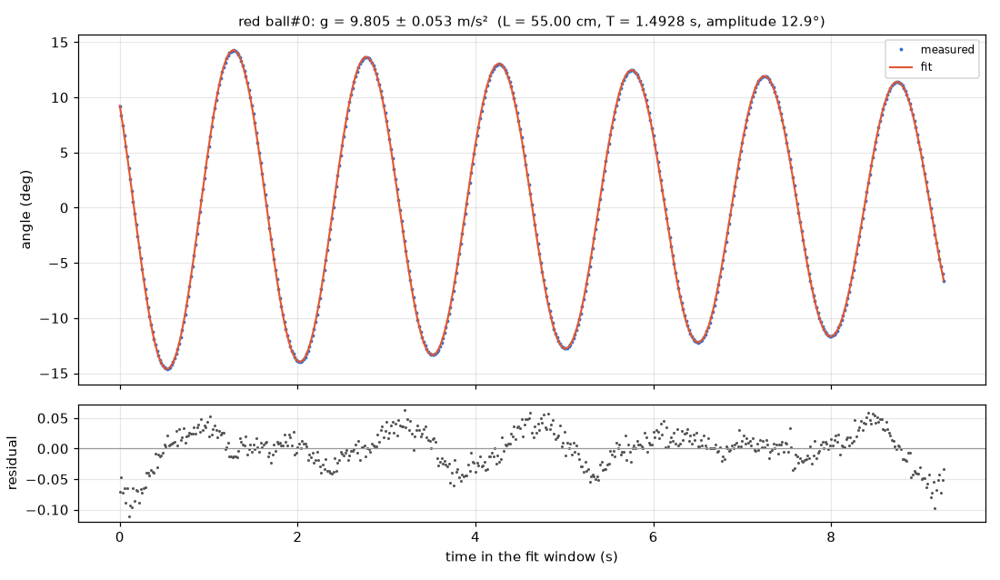

# Simple pendulum

**Measured g = 9.805 ± 0.053 m/s² from a 55.0 cm pendulum, agreeing with the reference 9.80665 m/s² to within 0.01%.**

**Law:** `θ(t) = θ0·e^(−γt)·cos(2πt/T + φ), with T ≈ 2π√(L/g) (small-angle period 1.48809 s, corrected for the 12.9° amplitude to the observed 1.49285 s)`

| Quantity | Value | Unit | Note |
|---|---|---|---|
| gravitational acceleration g | 9.805 ± 0.053 | m/s² | ± one standard error; dominated by the ±0.3 cm hand-measured length uncertainty (0.55% relative), period error is negligible; -0.012% vs reference 9.80665 m/s² |
| pendulum period T | 1.492850 ± 0.000018 | s | observed period at 12.95° amplitude; small-angle period 1.48809 s |
| arc radius (video cross-check of length) | 55.12 ± 0.55 | cm | circle fit to the tracked arc, agrees with hand-measured 55.0 cm string length |
| damping rate γ | 0.030132 ± 0.000054 | 1/s | from damped-sinusoid fit; quality factor Q ≈ 69.8 |
| swing amplitude | 12.95 | deg | initial amplitude from pendulum fit |

### What this means

A red ball hangs from a string and swings back and forth like a pendulum. Its swing angle follows a cosine wave that slowly shrinks because of air resistance and friction. By timing the swings (period 1.493 s) and using the 55.0 cm string length, the pendulum formula gives gravity as 9.805 ± 0.053 m/s², essentially identical to the accepted value. The uncertainty is dominated by how precisely the string length was measured by hand, not by the timing.

### Models compared

| Model | BIC | rms | Verdict |
|---|---|---|---|
| `damped sinusoid θ = A·e^(−kt)·cos(wt+p)+c (pendulum model)` | -8405.0 | 0.000514 | preferred; angle rms 0.029°, R²=0.999989 |
| undamped sinusoid θ = A·cos(wt+p)+c | -4870.2 | 0.0123 | rejected decisively; BIC worse by 3535, rms 24× larger |

### Data quality

- Full coverage: 600/600 frames tracked, no gaps (largest gap 0 frames), 557 points in fit window 0.717–9.983 s
- Scale check excellent: reference sheet sides agree to 0.14% (10.034 vs 10.048 px/cm)
- Arc fit rms only 0.009 cm and arc radius 55.12 cm matches hand length 55.0 cm
- Residual Durbin-Watson low (0.25) indicating smooth tracking noise, but model comparison by BIC is decisive

### Next steps

- Measure the string length more precisely (e.g. to ±0.05 cm) to shrink the dominant uncertainty
- Film more swings or repeat releases to average the period further
- Start from a smaller angle (<5°) so the small-angle formula applies almost exactly
- Re-check the cm scale with the reference sheet at the pendulum's depth to rule out parallax

_Analysed by muse-wonder-1.0 in 3 model calls and 4 tool calls, about $0.12 of API usage (33 s)._
